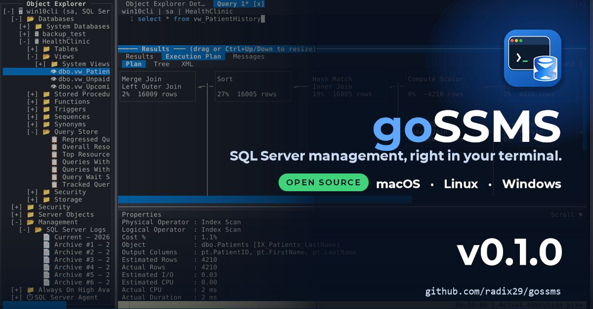

# 🚀 goSSMS v0.1.0 is now available!



goSSMS is a free, **open source**, terminal-based SQL Server management tool. It runs on **macOS, Linux and Windows** as a single executable, with no installer, client tools or separate database drivers. It supports SQL Server 2016 SP1 and later.

🎯 **The goal: functional parity with SQL Server Management Studio.** goSSMS mimics the functionality of SSMS and aims to match it feature for feature, so SQL developers on macOS and Linux get the tooling they have been missing, and life gets a lot easier.

## ✨ Features

- **Object Explorer** for databases, tables, views, programmability, security, Query Store and management
- **Query editor** with IntelliSense and multiple query tabs
- **Visual execution plans** (graph, tree, XML) and Live Query Statistics
- **Results grid**, Messages pane that jumps to the error line, export to CSV or file
- **Activity Monitor**, with `sp_WhoIsActive` bundled
- **Query Store** reports
- **Backup and Restore** with safety checks
- **Database Snapshots**
- **Database Files** shrink and grow, plus disk usage charts
- **Always On Availability Groups**
- **Logins, server roles**, login policy and unlock
- **Change Tracking**
- **Microsoft Entra ID** sign-in with seven methods, including Device Code for SSH sessions
- **Saved connections** with encrypted passwords, TLS encryption and Strict (TDS 8.0)
- **Crash recovery** for unsaved query tabs
- ...and many more!

## 📦 Install

### macOS and Linux — Homebrew
Apple silicon, Intel, and Linux (amd64/arm64).

```bash
brew install radix29/tap/gossms
```

### Debian, Ubuntu and derivatives — APT
GPG-signed repository for `amd64` and `arm64`.

```bash
sudo install -d -m 0755 /etc/apt/keyrings
curl -fsSL https://radix29.github.io/apt/gossms.asc \
  | sudo tee /etc/apt/keyrings/gossms.asc > /dev/null
echo "deb [signed-by=/etc/apt/keyrings/gossms.asc] https://radix29.github.io/apt stable main" \
  | sudo tee /etc/apt/sources.list.d/gossms.list > /dev/null
sudo apt-get update && sudo apt-get install gossms
```

### Direct download
Windows (amd64, arm64), Linux (amd64, arm64) and macOS (arm64, amd64).

1. Download the archive for your platform from the release page and extract it.
2. **Windows:** open PowerShell in the extracted folder and run:

   ```powershell
   .\gossms.exe
   ```

3. **Linux and macOS:** open a terminal in the extracted folder and run:

   ```bash
   chmod +x ./gossms && ./gossms
   ```

Installed with Homebrew or APT, just run `gossms`.

### 🛡️ Windows Defender / SmartScreen

The Windows binaries are built by GitHub Actions and are **not code-signed**, so on first run Windows Defender SmartScreen may show *"Windows protected your PC"* and ask for permission. This is expected for unsigned open source software. To continue, click **More info**, then **Run anyway**. If you prefer, unblock the download first:

```powershell
Unblock-File .\gossms.exe
```

Integrity is covered by `checksums.txt`, published with every release and signed with [cosign](https://github.com/sigstore/cosign), so you can verify the download before running it. Homebrew and APT installs are verified by the package manager.

## Links

- ⬇️ [Direct downloads](https://github.com/radix29/gossms/releases)
- 💻 [GitHub repository](https://github.com/radix29/gossms) — source code and issues
- ⭐ **Star and watch** the repo on GitHub (Watch > Custom > Releases) to get notified about new releases
- 🖼️ [Screenshots on the wiki](https://github.com/radix29/gossms/wiki)
- 💬 [Join the Discord](https://discord.gg/7YVKzB3vZ) — questions, feedback and release announcements
- 📜 [License: GPL-3.0-or-later](https://github.com/radix29/gossms/blob/main/LICENSE) — free to use, study, modify and share
- 📋 [Release notes](https://github.com/radix29/gossms/blob/main/RELEASE.md)

Feedback, bug reports and contributions are always welcome!

> 🤖 **Disclaimer:** goSSMS is developed with the help of AI.

#goSSMS #SQLServer #OpenSource #DatabaseTools #TerminalUI #macOS #Linux #Windows
